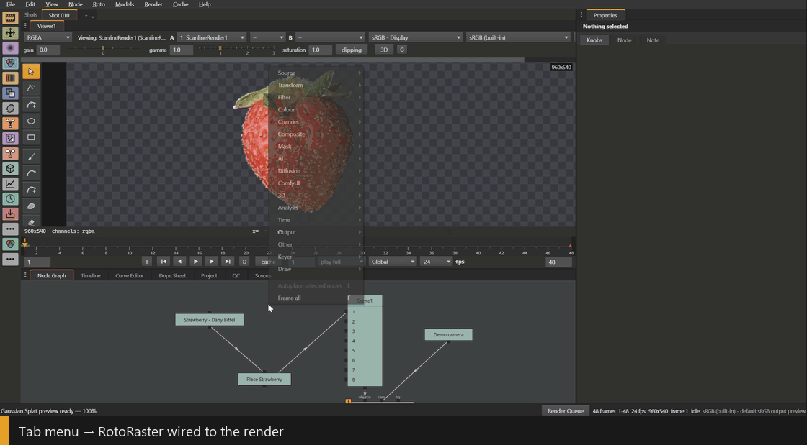
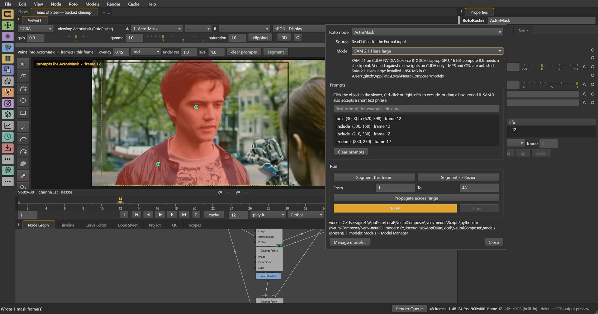
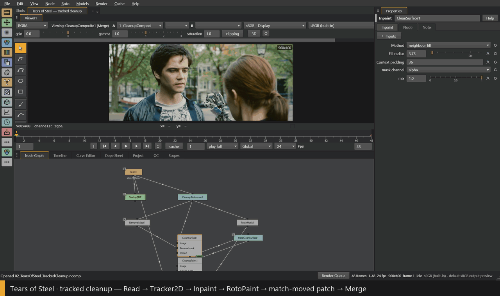
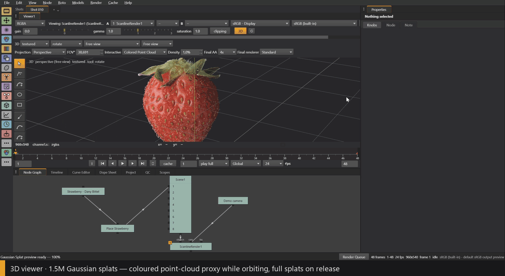

# Neural Composer

Neural Composer is node-based compositing software for VFX and animation,
with machine learning built into the node graph. You key, roto, track, clean
up and grade the way you would in any compositor. SAM, ViTMatte, Stable
Diffusion, FLUX, depth estimation, upscaling and ComfyUI workflows are just
more nodes, and they work on the same scene-linear images as everything else.
You can bring your own checkpoints through the built-in Model Manager.

It's written in Python and Qt, with C++ kernels and OpenGL where speed
matters. Images are premultiplied `float32` in scene-linear light. The
interface follows Nuke's conventions, so a compositor can sit down and use it
straight away.



## Smart Roto and Smart Mask



<sub>A box, two include clicks and one exclude click on a *Tears of Steel*
plate. SAM 2.1 runs on the GPU and writes a Smart Mask layer into the
`RotoRaster` node, shown here as the red overlay.</sub>

You click the object in the viewer, Ctrl-click anything to exclude, or drag a
box. With SAM 3 you can also type a short text prompt. SAM 2.1 or SAM 3 then
builds a Smart Mask layer in a `RotoRaster` node and propagates it over the
shot. Propagation runs both ways from the frame you marked. On the demo shot,
SAM 2.1 reaches 0.963 IoU against a hand-traced matte, compared with 0.891
for the built-in tracker.

An ML mask is rarely perfect, and fixing one pixel by pixel isn't practical.
So the next steps are the ones a compositor would take anyway:

- **MatteRefine** runs ViTMatte on the edge band, for soft edges and hair.
- **Hand edits.** You can correct a Smart Mask's boundary by hand. *Segment →
  Bezier* turns the mask into ordinary keyed Bezier shapes that you edit like
  hand-drawn roto.
- **Roto tracking** follows the selected shapes through the shot in the
  background, with an affine fit per shape. You can stop it and correct a
  shape at any frame.

The SAM model is also split into separate nodes: `LoadModel`, `ImageEncode`,
`MaskDecode` and `Prompts`. Each node is cached on its own inputs, so
dragging a prompt re-runs only the decoder. That takes 11 ms, against 103 ms
for the full model on an RTX 3080 Laptop GPU.

## Keying

- **ChromaKey and Despill.** Despill can remove spill along a sampled screen
  hue and restore the lost luminance.
- **ImageKey** keys against a clean plate.
- **CleanScreen** extends the screen colour through the foreground.
- **ColorKey** builds a key from several foreground and screen samples.
- **RangeKey** keys luminance or channel ranges.
- **EdgeExtend** repairs contaminated edge colour.
- **Smart keying.** A rough key goes through MatteRefine. ChromaKey then takes
  the refined matte back and subtracts the screen from the mixed edge pixels,
  so fine hair edges survive without a separate hand-built edge key.

## Cleanup and tracking



**Tracker2D** solves translation, rotation, similarity or a planar
homography. The track can drive a Transform, a Stabilize, or a CornerPin with
four editable perspective corners. *Create cleanup patch* builds the whole
patch branch from a tracked reference frame: paint, grade, mask and
match-move.

**Inpaint** fills a removal mask from the surrounding pixels, or with SD 1.5
or SDXL inside a bounded crop. Only the masked pixels change. **RotoPaint**
has brush, clone, smear, blur and restore tools.

In the clip above, a snap button is painted out on one frame and carried
through the shot with a measured track. The orange box marks the patch.

## Models

The Model Manager installs and verifies models (with SHA-256 checks),
registers your own checkpoints from disk, and can A/B-test two segmentation
models on the same clicks. Inference runs in a separate worker process, so
the compositor itself never loads PyTorch.

- **Diffusion nodes** for SD 1.5, SDXL and FLUX.1 schnell, with LoRA,
  ControlNet, image-to-image and inpainting. SDXL at 1024×768 with 25 steps
  takes 9 s.
- **Depth Anything V2** for depth, and **Real-ESRGAN** for upscaling.
- **ComfyUI.** Run a saved workflow on a ComfyUI server, or load its node
  classes into the graph and wire them together with comp nodes.
- **Replicate** for paid models. The API key stays in the OS keychain.

## 3D and Gaussian splats



Gaussian splats load as regular geometry. You can place them, animate them
with keyed transforms and cameras, combine them with meshes and render them
into the comp through ScanlineRender. The viewer sorts the whole cloud on the
GPU, so a full frame of the 1.5-million-splat strawberry above draws in about
143 ms on an RTX 3080 Laptop. While you orbit, a coloured point proxy keeps
the viewer responsive. You can also box-select splats and delete them. The
edit is stored in a `SplatEdit` node, and the source PLY stays untouched.

Besides splats, the 3D side reads Alembic, FBX, Maya ASCII, USD, OBJ and PLY.
I wrote the Alembic, FBX and Maya readers myself; against Maya 2020, vertex
positions match to within 1e-15. Camera solving runs on COLMAP.

## Command line and agents

Project files are plain JSON. Anything the GUI renders can also be rendered
headless, and the result matches the GUI pixel for pixel:

```bash
python -m neural_composer render  shot.ncomp -X Write1 -F 1-48 -o renders/comp.####.exr
python -m neural_composer analyze shot.ncomp --node Merge1 --json qc.json --strict
```

`analyze` runs the same technical QC as the app: clipping, NaNs, broken
premultiplication and jumps between frames. With `--strict`, a failed check
returns a non-zero exit code.

I use this with Claude Code and Codex. The agent gets a template graph and a
written shot workflow. It edits the project, renders and reads the QC report,
and then I review the shot in the GUI.

## Status

Neural Composer is in active development. For now this repo holds the
overview while I clean up the source for release. All the numbers above were
measured on a laptop with an RTX 3080 Laptop GPU (16 GB).

## Credits

- Strawberry splat capture by Dany Bittel
  ([superspl.at](https://superspl.at/scene/84df8849)), CC BY 4.0.
- *Tears of Steel* (2012) by the Blender Foundation / Blender Institute
  ([mango.blender.org](https://mango.blender.org/about/)), CC BY 3.0. A
  resized 48-frame excerpt.

## Author

Dmitri Ginzburg, a software engineer and technical director in London, with
over 15 years of building tools and pipelines for animation and VFX.
[GitHub](https://github.com/ginzburg-dev) ·
[LinkedIn](https://www.linkedin.com/in/ginzburg-cg/) ·
[Neural Denoiser](https://github.com/ginzburg-dev/ginzburg-neural-denoiser)
